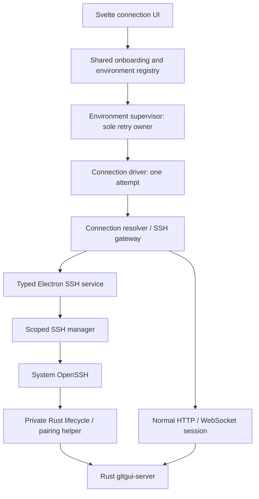

# Remote connection reliability: architecture and implementation tasks

Date: 2026-11-03. Status: research and proposed architecture; not implemented.

## Task and completion goal

Bring GitGui's remote connection lifecycle into practical parity with T3 Code.
Reliably discover, launch or attach, authenticate, reconnect, cancel, and dispose
SSH connections while preserving environment identity and exact process ownership.
Copy applicable upstream modules and failure tests directly. Translate Node server
work to Rust and React integration to Svelte; record other necessary differences.

Completion means Windows and Linux desktops can repeatedly connect to real Linux
hosts, recover interrupted first onboarding and server/tunnel loss, and cancel,
remove, or quit without lost ownership, credential dead ends, duplicate retry
loops, or effects on another environment.

Remote updating is a later milestone. This task does not add npm distribution,
automatic binary provisioning, a service installer, relay/control-plane services,
or an updater/rollback launcher. Initially `gitgui-server` remains required on the
remote PATH. Managed SSH hosts are Linux first, matching the current POSIX runner;
native Windows SSH hosting needs a separately qualified runner. Compatible direct
HTTP/WebSocket servers remain independent of that SSH-host restriction.

## Baseline and research evidence

- GitGui main: `11149a2f8c743e2f4225b57af45327be6403e6fd`, including released
  updater commit `477542d61a0b26d931e33d330bd19a76c2ea1bcd`.
- T3 inspected: `70cd258d8aac43ea57494527b00bf36de3efa6c0`, in
  `D:/GitHub/PictureTagingApp.references/t3code`.
- Both checkouts were clean before research. This document is based on source
  inspection, the earlier independent reviews, and one isolated local key-collision
  probe. No real SSH host or installed upgrade was exercised during this research.

| Concern | T3 source | GitGui source |
| --- | --- | --- |
| Boundaries | `docs/internals/{workspace-layout,connection-runtime,remote,environment-auth}.md` | `AGENTS.md`, `docs/{architecture,connection-runtime,t3code-vendoring}.md` |
| Config, commands, auth | `packages/ssh/src/{config,command,auth,errors}.ts` and tests | `packages/ssh/src/index.ts` and tests |
| Launch and cleanup | `packages/ssh/src/tunnel.ts`: scripts, pending entries, entry scopes, stop | `packages/ssh/src/{index,cancellation}.ts`, lifecycle tests |
| Desktop service/prompts | `apps/desktop/src/ssh/{DesktopSshEnvironment,DesktopSshPasswordPrompts}.ts`, IPC `sshEnvironment.ts` | Desktop `main.ts`, `preload.cts`, `state-store.ts`, bridge contracts |
| Onboarding/reconnect | Shared `connection/{onboarding,resolver,supervisor}.ts`, web `connection/platform.ts` | Web `lib/connection/{runtime,platform}.ts`, shared resolver/driver/supervisor/registry |
| Pairing/session lifetime | Server `auth/{EnvironmentAuth,PairingGrantStore,SessionStore}.ts` | Rust server `auth.rs`, `main.rs`, `lib.rs` |

### Confirmed gaps

1. **Interrupted launch loses remote ownership.** The shell script starts a
   detached process before returning its launch result, and writes managed kind
   only after readiness. Cancellation kills local SSH and bypasses remote cleanup.
   Late output is ignored. This is the P2 explicitly deferred for release 0.1.6.
2. **Authentication recovery is tied to launch.** A new process receives a
   bootstrap over stdin; reuse returns no grant. Lost client credentials or an
   interrupted first onboarding cannot independently obtain fresh credentials.
   T3 separates launch from remote CLI pairing issuance.
3. **State keys can collide.** GitGui truncates base64 of the input target key to
   48 characters. A local non-secret probe reproduced different port/identity
   targets under one long hostname mapping to the same remote key. T3 hashes the
   complete key before shortening its digest.
4. **Auth is process-local.** Rust `AuthStore` keeps sessions, pairing grants,
   and tickets in memory. Its bootstrap is reusable for the process lifetime;
   ordinary pairing grants are single-use. A separate CLI process cannot issue
   a grant into the running server's current in-memory map. T3 has durable auth
   and independently issued pairing grants.
5. **Attach and ownership evidence are incomplete.** GitGui accepts `external`
   results in its types/tests, but its launcher only reuses managed metadata or
   starts another server. PID liveness substitutes for readiness/ownership, with
   no host-side start lock or per-attempt generation.
6. **Reduced config/auth copy.** Discovery omits Include expansion and resolved
   `ssh -G` targets. Host trust shares the password/askpass retry path. IPC errors
   are messages classified by regex instead of structured failure categories.
7. **Onboarding cancellation has a boundary gap.** Scoped runtime interruption
   does not cancel a renderer Promise's Electron work. Disconnect only finds
   registered entries. `addSsh` has a separate unchecked/unbounded descriptor read
   and no acquisition finalizer around authentication/registration persistence.

Keep the foundations that already work: server-issued EnvironmentId, scoped
supervisors, saved bearer reuse, identity validation, generation replacement,
protected credential storage, and bounded prompt/readiness behavior.

## Target architecture



Rust owns auth, identity, repositories, and host state. Electron owns SSH
processes, prompts, credential protection, and desktop lifecycle. Svelte renders
structured state. Normal discovery/auth and Git requests keep their common
HTTP/WebSocket boundary; no Git proxy or arbitrary command IPC is introduced.

### A. Copy scoped modules instead of another Promise manager

Port T3's `config.ts`, `command.ts`, `auth.ts`, `errors.ts`, and `tunnel.ts` with
their applicable tests into `packages/ssh`. Add thin desktop service/prompt
adapters following `DesktopSshEnvironment.ts` and `DesktopSshPasswordPrompts.ts`.
Keep Promise conversion at IPC, not as the resource lifetime owner. Replace the
bespoke cancellation helper once its failure coverage is carried into the port.

Use Effect scopes for manager, acquisition, command, tunnel, and prompt lifetime,
as T3 does. This uses GitGui's already-selected runtime library to address actual
ownership defects, not merely architectural resemblance. Rust-specific launch
and pairing behavior stays behind one runner adapter.

**Compatibility gate:** GitGui pins Effect and `@effect/vitest` to 4.0.5, while
this T3 checkout uses 4.0.0-beta.103 with unstable HTTP/process imports. The current
runtime manifest records another snapshot, `1688f965682d331da16a8c39f049592361f69c8d`.
Verify a compatible scoped process/HTTP/prompt spike before implementation. Do
not downgrade, claim incompatible bodies are verbatim, or bulk-resync the runtime.
If the spike fails, resolve that blocker rather than silently rebuilding scopes.

Keep the existing runtime pin independent. Extend provenance tooling for a
separately pinned SSH source set. Record upstream paths/hashes, concrete
adaptations, and matching failure tests. Hash recording alone is not proof of
behavioral parity. T3's current code also does not prove cleanup for every
interrupted remote launch; the ownership handshake below is an explicit GitGui
correction, not a claimed upstream guarantee.

### B. Separate environment, route, target, and process identity

| Identity | Owner and meaning |
| --- | --- |
| EnvironmentId | Rust-issued stable UUID in the persistent environment directory; workspace/cache identity. |
| ConnectionId | Client-owned saved route; several routes/keys may reach one environment. |
| Target key | Canonical alias, resolved host/user/port and explicit identity override; acquisition deduplication. |
| Acquisition/instance IDs | Per-attempt ownership and process generation; evidence for claim, cancellation and cleanup. |

Hash the complete canonical target, following T3's approach. Use full SHA-256
filename digests and verify the stored canonical identity. The full digest and
GitGui's identity-file override are recorded adaptations. Never derive an
EnvironmentId from a digest, address, PID, or forwarded port.

Separate the selected remote environment/data directory from transport identity.
New connections discover/attach the ordinary per-user environment by default,
following T3's default-home reuse concept. Existing per-target directories remain
selected through migrated explicit remote locators. Changing an SSH key must
not silently create a different environment or move a catalog.

### C. Own the remote process before waiting for readiness

The Rust binary supplies a small versioned host-local helper interface: probe,
ensure, claim, cancel, release, and pairing issuance. These are proposed logical
operations, not implemented CLI commands or instructions to run them today.
Keep them behind the SSH runner abstraction. They do not install a service or
expose public network shutdown/update RPCs.

Rust owns helper wire definitions in `gitgui-protocol`; generate TypeScript.
Version this private helper contract separately from the Git RPC and Electron
bridge contracts. Exchange bounded structured frames, not application-log regex.
Treat helper output, persisted metadata and descriptors as untrusted: schema-decode
them with size limits, accept only the locally reserved loopback forward, and
reject auth/discovery redirects outside that endpoint. Never accept an arbitrary
URL or process command through the lifecycle helper's result.

Store an atomic, permission-restricted host runtime record with schema version,
acquisition ID, instance ID, selected data directory, EnvironmentId when known,
actual bound port, ownership class, process identity, setup/cleanup state, and
provisional expiry. Store no bootstrap, pairing token, bearer or SSH secret here.

Use a data-directory process lock and short host-side state transactions, also
covering two desktop processes. Do not hold that lock throughout readiness or
prompts. Record ownership before readiness; cancellation must work by the known
acquisition ID even if no result reaches the desktop.

```text
reserved -> starting -> ready-unclaimed -> claimed
    |           |              |
    +-----------+--------------+----> cancelling -> stopped
                                          |
                                          +----> cleanup-pending (observable)
```

Cancel records a tombstone before cleanup. Ensure checks it at the launch
decision, after spawn, and before success/claim. This prevents a slow launcher
starting after cancellation has already swept the host. Fresh attempts use new
IDs; stale results cannot overwrite a newer instance.

New processes stay provisional until identity, authenticated RPC welcome, and
durable client persistence succeed. The setup helper supervises its provisional
child and handles SSH EOF. A server-enforced unclaimed deadline covers helper
death or lost transport. Claim/cancel are linearized: no late success after
cancellation. This is a bounded setup handshake, not a service/update launcher.

Use an OS-user-restricted, instance-checked local owner control endpoint for
cooperative Rust admission/drain/stop, reusing existing server lifecycle logic.
For the Linux host this can be a private Unix socket. Never signal a process
solely because its PID file is live, or force-kill active Git work for cleanup.

Ownership rules:

- A new instance belongs to its provisional acquisition until claim.
- A reused same-owner instance gets a usage handle. Failing/cancelling one
  waiter does not kill an instance or tunnel used by another successful handle.
- External or foreign-owned servers are attach-only: validate identity/readiness
  but never stop or silently adopt them. Missing proof is not ownership.
- Shared/busy managed servers can be intentionally retained with accurate
  metadata and a typed deferred result; do not interrupt another active client
  or started Git operation just because one desktop exits.
- When cleanup cannot reach the host, retain a cleanup-pending journal entry;
  do not claim observed exit. Provisional expiry bounds abandoned setup. Reconcile
  committed/shared records on the next successful connection.

Crash recovery validates records and instance identity; it never kills matching
processes by name or deletes persistent environment data.

### D. Pair independently from launch

Copy T3's separate remote pairing issuance. SSH authenticates the remote OS user;
the Rust helper issues a fresh one-time credential for that selected environment.
It works for reused servers and lost client credentials. Restarting a healthy
server to obtain credentials is not the recovery mechanism.

Introduce a small durable Rust auth repository for grants and bearer sessions,
using SQLite for atomic cross-process issuance/consumption, expiry and revocation.
Keep Git catalogs/caches in their current storage. Preserve existing opaque wire
tokens and HTTP contracts; store credential digests using a persistent server
secret. This is the Rust translation of T3's durable auth semantics, not a need
to copy its token encoding. WebSocket tickets stay process-bound and single-use.

Preserve the primary desktop bootstrap flow during this milestone. A global
one-time-bootstrap cutover needs separate compatibility work. New SSH pairing
uses independently issued one-time grants; it does not persist reusable process
bootstrap material in connection or launch metadata.

Scope translation is explicit: ordinary pairing currently grants only
`repository:read` and `repository:operate`; remote catalog management also needs
`repository:manage`. OS-owner SSH issuance grants these three scopes. Do not
accidentally remove catalog access or automatically grant every client
`access:write`. Ordinary direct pairing retains its existing limits.

Reconnect validates the saved bearer first. If absent/rejected, issue and
exchange one fresh pairing grant through the normal `/oauth/token` flow.
Permission failure, network timeout, invalid response and identity mismatch do
not authorize refreshing credentials. Persist replacements only for the expected
EnvironmentId; healthy reconnects must not mint another session each time.

### E. One onboarding transaction and one reconnect owner

1. Resolve system SSH config and authenticate/trust the host.
2. Acquire or attach the selected environment and open its forward.
3. Fetch/decode its descriptor through the shared bounded HTTP utility.
4. Validate saved access or issue/exchange the one-time grant.
5. Verify a live RPC welcome, identity, protocol and capabilities.
6. Persist protected credentials and non-secret registration consistently.
7. Claim newly managed ownership and hand the session to the registry/supervisor.

Failure/cancellation before handoff closes the acquisition scope, cancels prompts
and IPC work, disposes the tunnel and cancels provisional ownership. Electron
needs a narrow atomic registration/credential persistence operation; a failed
save must leave no usable-looking partial registration or leaked new credential.

The readiness preflight uses the existing driver/session factory once and closes
its temporary RPC scope; it is not a second long-lived session or retry loop.
Stage the registration and protected credential without publishing an active
workspace, claim the remote acquisition, then activate the ordinary supervisor.
A crash between durable staging and claim leaves an explicitly recoverable setup
record, not a connection falsely shown as ready. Reconcile or roll back that
record on restart. Changes to this registry activation boundary must remain a
narrow, documented adaptation in the vendored module and its tests.

Port applicable shared onboarding behavior rather than adding another `addSsh`
network flow. Keep GitGui's common direct client-to-server auth/discovery path:
current T3 proxies some SSH HTTP/auth calls through Electron, whereas GitGui's
working direct boundary is an explicit adaptation. Do not proxy Git RPCs.

IPC uses typed results and a trusted-renderer-bound operation ID with narrow
cancellation. AbortSignal objects do not cross IPC. Scope interruption/removal
cancels the actual acquisition; completed/stale IDs cannot affect another owner.
Cancelling one waiter cannot destroy a shared live resource. Desktop quit/update
closes admission, interrupts acquisitions, drains bounded finalizers, and reopens
admission only after successful local backend recovery.

The environment supervisor remains the only reconnect retry owner. Prepare the
SSH bridge before opening the replacement RPC session. Bounded readiness probes
and auth retries are single-attempt internals, not another reconnect loop. Normal
socket loss retains registration/credentials. Explicit route/environment removal
clears the matching scopes, credentials and client state without deleting remote
repositories or disturbing other environments.

Keep the expected EnvironmentId pinned when DNS, port forwards or aliases change.
Re-onboarding a different environment is explicit. Session replacement advances
the existing generation, switches subscriptions and revalidates reads; it never
replays uncertain Git mutations.

### F. Config, prompts, classification and timing

Copy Include-aware discovery and `ssh -G` resolution. Preserve the alias for
OpenSSH so ProxyJump, Match, identities and agents continue working. Apply explicit
user/port/identity overrides identically to launch, tunnel, pairing and cleanup.

Host trust is separate from password/passphrase auth. Never pass literal `yes`
through the password helper as host-key acceptance. Unknown-host confirmation
must show the actual host/port and fingerprint, pin the approved key for retry,
and use the system known-hosts database. Changed known keys block for explicit
resolution. Verify this with real OpenSSH, not string-only script assertions.

Port upstream Windows/POSIX askpass helpers; avoid an independently maintained
Windows `set /p` secret adapter. Cache SSH auth secrets only in the scoped service;
discard them on rejection/disposal. Secrets never enter argv, logs, generic
settings, renderer bundles or persisted launch output.

Use typed, bounded IPC error categories instead of regex as a classification
contract. Transport loss is transient under supervisor backoff. Cancelled,
rejected or expired auth prompts block for explicit action; host trust failures
block permission. Bad profile/unsupported helper/protocol blocks configuration
or compatibility. Identity mismatch blocks without fallback or re-pairing.
Cleanup uncertainty returns retained/cleanup-pending with safe diagnostics.

Initial budgets copy T3 where applicable: SSH connect 10s, launch command 90s,
remote startup 60s, forwarded readiness 20s, individual probe 1s, prompt 3 minutes.
Pairing helper gets 10s; owned remote cleanup retains GitGui's 15s budget, local
tunnel termination gets 2s. Proposed unclaimed expiry is 120s after remote
readiness; verify it against auth/RPC/save deadlines before finalizing. Request
timeouts include body consumption. A budget never authorizes killing active Git
work. Timers/listeners/fibers belong to scopes and are released on every outcome.

## Migration and compatibility

- Add versioned locator/ownership metadata to desktop profiles while preserving
  ConnectionId and EnvironmentId. Use existing catalog migrations, with protected
  credentials separate from ordinary records.
- Resolve legacy base64 keys to their existing data directory and verify actual
  server identity before recording a hashed locator. Never merge/rename data
  directories solely from a target calculation.
- Colliding legacy keys or unverifiable ownership require explicit selection,
  re-pairing or an actionable blocked result. Do not guess, kill, or delete an
  ambiguous environment. Failed migration preserves original metadata.
- Direct/primary registrations continue working. New/empty auth storage never
  silently enables anonymous access or broadens ordinary pairing scopes.
- Old servers without the helper contract report unsupported management; an
  explicitly configured normal endpoint/manual pairing can still work. Do not
  silently fall back to the unsafe old launch/cleanup implementation.
- Prefer additive public capabilities. Any public wire change starts in Rust
  and regenerates TypeScript; private helper and desktop bridge versions stay
  distinct. No remote-update RPCs are added as preparation for future work.

## Implementation task breakdown

Each task includes exact upstream provenance, declared differences, upstream-derived
failure tests and a validation record. These are code tasks, not authorization to
publish, tag or deploy. Coordinate shared protocol/integration files explicitly.

| ID | Deliverable / likely files | Dependencies | Acceptance |
| --- | --- | --- | --- |
| R0 | Pin SSH source/test set; Effect/platform compatibility spike; separate provenance metadata and sync-tool fixtures. | None | Scoped process/HTTP/prompt services work with the chosen GitGui pins; no hidden downgrade or runtime bulk sync; every file has a copy/adaptation/test map. |
| R1 | Port `config`, `command`, `auth`, `errors`; desktop prompt adapter and upstream tests. | R0 | Include/globs/multiple aliases, ssh-G, ProxyJump, identity overrides, native trust/password flows, deadlines, cancellation and Windows askpass pass without secret output. |
| R2 | Rust runtime record, start lock, structured helper protocol, provisional claim/cancel, exact-instance cooperative cleanup and pending-cleanup journal. | R0 | Lost launch result/EOF/helper death retain cleanup ownership; a still-running ensure cannot start after cancellation; competing desktop attempts yield one instance; external servers survive. |
| R3 | Rust durable auth repository and OS-owner pairing issuance; protocol/capabilities as required. | R0 | Another process issues a grant consumed once by the running server; restart, expiry, concurrent consume, revocation and scope limits pass. SSH clients can manage catalogs; ordinary pairing is unchanged. |
| R4 | Scoped tunnel manager with Rust runner, typed desktop SSH service/IPC cancellation; remove superseded Promise lifecycle. | R1, R2 | Pending/ready/shared entries, waiter cancellation, late output, tunnel exit, app quit and update recovery preserve ownership and bounded finalizers. |
| R5 | Shared onboarding/gateway/resolver integration, atomic Electron credential/registration persistence, structured UI progress/errors. | R3, R4 | Live RPC is verified before save/claim; failed save/cancel rolls back acquisition; healthy bearer is reused and rejected bearer re-pairs once; mismatch/permission does not. |
| R6 | Profile/state-key migration and explicit remote locator; ambiguity/re-pair UX. | R2, R5 | Existing environment IDs, catalogs and saved routes survive; stale/foreign PIDs and key collisions block safely; failed migration preserves original state. |
| R7 | Multi-environment failure tests and isolated real OpenSSH/Agentbox qualification. | R5, R6 | Two environments survive cancel/remove/crash/wakeup independently; real SSH proves process ownership, password/key flows, tunnel replacement and interrupted-launch cleanup. |
| R8 | Independent parity review, completed failure matrix and architecture/vendoring/operator notes. | R7 | No unresolved ownership/credential/identity/retry defects; support limits and remaining differences are explicit. Remote updates stay deferred. |

Start with R0, then the interrupted-launch portion of R2 and host-side race
fixtures. That closes the known release P2 before the broader refactor finishes.
R1 and R3 can proceed as separate modules after R0; integrate their contracts
with R2 before R4/R5 replace the old path. Do not run two implementations side
by side as competing lifecycle owners.

## Failure matrix and qualification gate

- Cancel before spawn, after spawn/before receipt, during readiness, before
  pairing, after pairing/before save, during save, and around claim. Repeat with
  lost SSH output and killed helper; no late success or unowned provisional child.
- Race cancel/stop against a still-running ensure and a new generation; use
  stale PID/instance/key records and two desktop processes. No wrong-process stop,
  duplicate environment instance, or corrupted ownership record.
- Exercise missing/expired/revoked bearers, lost first pairing response, same-ID
  server restart, corrupt auth state, failed credential writes and limited scopes.
  No credential leak or repeated session issuance on healthy reconnect.
- Stall SSH/stdin, descriptor headers/body, and native prompts. Test incompatible
  helper/protocol, missing PATH binary, wrong environment, bad forward, changed
  host key and tunnel loss before/during RPC handshake.
- Cover ordinary quit, refused updater preparation, failed installer recovery,
  offline/online, sleep/wakeup, two active environments, and explicit route or
  environment removal while setup/reconnect is pending.
- Keep started Git work alive during cleanup, bound the caller's wait, retain
  ownership metadata and return the actual retained/cleanup-pending outcome.
- Migrate legacy profiles/keys without changing catalog, identity, selection or
  unrelated credentials/workspace state.

Use isolated data directories and only owned test processes. Agentbox can qualify
Linux server/SSH behavior; real Windows and Linux desktop/OpenSSH passes qualify
host integration. Mocked dialogs do not qualify native presentation. SSH tests
do not establish installed upgrade behavior. No remote environments were changed
as part of writing this plan.

## Implementation record

Implementation began on main at the baseline above on 2026-11-03. The original
research/proposal is retained here; actual implementation choices, executed
failure tests, review corrections and remaining platform qualification are
tracked in [the validation record](remote-connection-reliability-validation.md).
The SSH source set is pinned separately; the original runtime snapshot and
Effect 4.0.5 pins are retained. The known interrupted-launch gap is addressed by
the Rust host acquisition/tombstone/expiry contract, not by another shell cleanup
heuristic. Managed ready expiry is 300s instead of the proposed 120s to accommodate
authentication and live validation. Real native/installer qualification remains
separate from fixture evidence.
